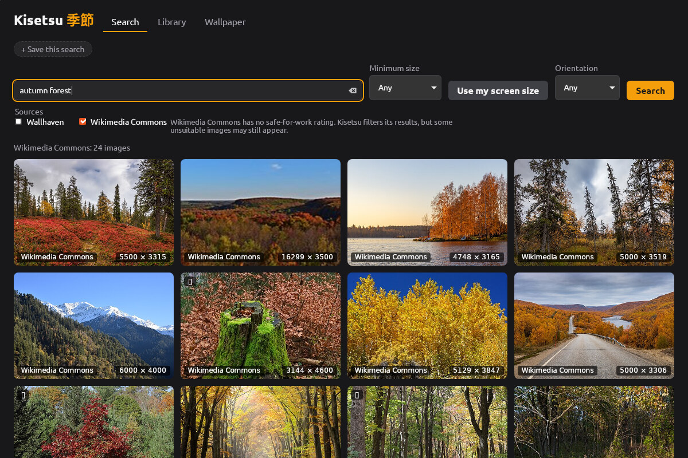

# Kisetsu 季節

Find beautiful wallpapers, keep the ones you like, and let your desktop
change with them.

Kisetsu (Japanese for "season") searches several image sources at once,
keeps a local library with the author and license of every image, and
sets or rotates your desktop wallpaper. It is free and open source (MIT).



<sub>Photographs from Wikimedia Commons by their authors, under CC BY-SA
and CC0 licenses — see [the credits](docs/screenshot-credits.md).</sub>

> **Status:** version 0.4.0, for Linux and Windows.

## Features

- **Search** Wallhaven and, if you turn them on, Wikimedia Commons and
  museum collections through Openverse, at the same time. Filter by minimum size (or "my screen size"),
  orientation and Wallhaven category (General, Anime, People); exclude
  words with `-word`, e.g. `mountains -snow`.
- **Save searches** and run them again with one click.
- **Library:** download images to keep them. They work offline, can be
  sorted into collections, and duplicates are detected — also re-encoded
  copies of the same picture.
- **Credit where it is due:** author, source page and license are kept
  for every image and shown with it.
- **Set as wallpaper**, or **rotate** automatically — every 15 minutes up
  to once a day, in random or added order, from the whole library, a
  collection, or a saved search.
- **Fresh images from a saved search:** when rotating from a saved
  search, Kisetsu downloads a few new images when it runs low. They live
  in a size-limited cache (200 MB, reduced to your screen size); press
  **Keep** to move one into your library.

## Install

Both files are on the
[latest release](https://github.com/sentivanac/kisetsu/releases/latest).

### Linux

Packaged for **Ubuntu 22.04 or newer, Linux Mint 21 or newer and Debian
12 or newer** (64-bit). Download `kisetsu_0.4.0_amd64.deb` and install it
with (an older version is replaced):

```sh
sudo apt install ./kisetsu_0.4.0_amd64.deb
```

`apt` also installs what Kisetsu needs (GTK 3 and WebKitGTK 4.1). If it
says a package cannot be installed, its package lists are out of date
(common on a freshly installed system): run `sudo apt update` and try
again. Then start **Kisetsu** from the applications menu, or run
`kisetsu`.

### Windows

For **Windows 10 and 11** (64-bit). Download
`kisetsu-0.4.0-windows-amd64-setup.exe` and run it. It installs for your
user only, without administrator rights, and replaces an older version.

The installer is not signed yet, so Windows may warn before starting it
("Windows protected your PC"): choose **More info**, then **Run anyway**.
Windows 11 with *Smart App Control* turned on blocks unsigned programs
altogether.

To build it yourself, see [docs/development.md](docs/development.md).

## Supported desktops

| Desktop | Set wallpaper | Rotation |
|---|---|---|
| Windows 10 and 11 | ✓ | ✓ |
| GNOME (X11 and Wayland) | ✓ | ✓ |
| MATE | ✓ | ✓ |
| Cinnamon (Linux Mint) | ✓ | ✓ |
| KDE Plasma 5.24+ (X11 and Wayland) | ✓ | ✓ |
| Xfce (X11) | ✓ | ✓ |
| Variety running (any desktop) | ✓ through Variety | — see below |
| Others (LXQt, i3, sway, …) | not yet | not yet |

On other desktops, search and the library work fully; only setting the
wallpaper says it is not supported yet.

**Variety:** if [Variety](https://peterlevi.com/variety/) is running,
"Set as wallpaper" hands the image to Variety, so Variety keeps working
as before. Kisetsu's own rotation sets the wallpaper directly, and the
Wallpaper tab warns that Variety would change it too: turn off Variety's
automatic change, or quit Variety, if Kisetsu should rotate.

**Rotation** runs in a small background process, `kisetsu agent`, so it
continues while the window is closed. Turning rotation on starts it and
adds it to the programs started at login (on Windows: Task Manager's
Startup tab); turning rotation off removes it from there, and the process
ends by itself. Linux desktops that do not start programs from
`~/.config/autostart` (i3, sway and other window managers) need
`kisetsu agent` in their own startup file.

**Tray icon** (optional, in the Wallpaper tab): its menu changes the
wallpaper, turns rotation on or off, opens the window, or quits until the
next login. On Windows it is in the notification area (it may be behind
the **^** arrow). Plain GNOME shows tray icons only with the extension
"AppIndicator and KStatusNotifierItem Support"; Ubuntu has it on by
default.

**On the wallpaper** (Wallpaper tab, both off by default): the image's
author, license and source, and a clock with the date if you like, each
in a corner of your choice. Kisetsu draws them on a copy of the image cut
to your screen size; the image in the library is not changed. Good to
know:

- The clock is redrawn every minute by the background process, so it
  runs while the clock is on, as for rotation.
- While the clock is on, Kisetsu keeps showing the wallpaper it set
  last: a wallpaper chosen in the desktop's own settings is replaced at
  the next minute. Turn the clock off to use one of your own.
- KDE Plasma and Cinnamon fade briefly to each new minute.
- The text is placed for your largest screen; on a screen of a
  different shape it may sit closer to the edge.
- Nothing is drawn while Variety sets the wallpaper; Variety has its own
  clock.

## Images and licenses

Kisetsu shows where every image comes from and under which license, but
**it does not make images free to use**. Check the license on the source
page before publishing or sharing an image.

- **Wallhaven:** only images rated safe for work are requested. Safe for
  work still includes suggestive pictures, mostly in the Anime and People
  categories; turn those categories off in the search form if you do not
  want them. The preview of a Wallhaven image lists its tags: click one
  (for example "barefoot") to hide images with it from all later
  searches; the search form lists hidden tags and shows them again.
  Licenses are often not stated; Kisetsu then says "License unknown".
- **Wikimedia Commons** (off by default): limited to its curated quality
  collections, with unsuitable results filtered out. Commons has no
  safe-for-work rating, so the filter cannot be perfect. Most images are
  under Creative Commons licenses that require crediting the author.
- **Openverse** (off by default): only collections whose files are large
  enough for a wallpaper: the Rijksmuseum, Museums Victoria, the
  National Gallery of Denmark (SMK) and the WordPress Photo Directory.
  Every image has an open license or is in the public domain. Museums
  include nudes in art, and the filter cannot be perfect. Without an
  account, Openverse allows 200 searches a day per network. Kisetsu uses
  Openverse but is not endorsed by it.

Kisetsu uses the official APIs of all sources, respects their rate
limits, and identifies itself to them as Kisetsu with its version.

## Privacy

Kisetsu has no account, no telemetry and no server of its own.

- Your searches go to the image sources you selected (Wallhaven,
  Wikimedia Commons, Openverse) — that is how they are searched.
- Thumbnails, previews and downloads are loaded from those sources'
  servers (for Openverse, from the museum or photo directory that holds
  the image).
- Everything else stays on your computer: library, collections, saved
  searches, settings and logs. Search text is not stored unless you save
  the search (or turn on debug logging, which writes it to the log).

## Where Kisetsu keeps its files

| What | Linux | Windows |
|---|---|---|
| Library images, thumbnails, database | `~/.local/share/kisetsu` | `%LocalAppData%\Kisetsu\data` |
| Fresh images from saved searches (max 200 MB) | `~/.cache/kisetsu` | `%LocalAppData%\Kisetsu\cache` |
| Log file (a new one is started above 5 MB; the previous is kept as `.1`) | `~/.local/state/kisetsu/kisetsu.log` | `%LocalAppData%\Kisetsu\state\kisetsu.log` |
| Start at login (only while rotation, the clock or the tray icon is on) | `~/.config/autostart/io.github.sentivanac.Kisetsu.Agent.desktop` | value `io.github.sentivanac.Kisetsu.Agent` in `HKEY_CURRENT_USER\Software\Microsoft\Windows\CurrentVersion\Run` |
| The program (Windows) | | `%LocalAppData%\Programs\Kisetsu` |

Kisetsu never deletes images from your library on its own; only the
cache of fresh images is cleaned up automatically.

## Uninstall

**Windows:** Settings → Apps → Kisetsu → **Uninstall**. It stops the
background process and removes it from the programs started at sign-in.
Your library stays in `%LocalAppData%\Kisetsu`; delete that folder to
remove it as well.

**Linux:**

1. In Kisetsu, open **Wallpaper** and turn rotation off. The background
   process stops and is no longer started at login.
2. Remove the program:

   ```sh
   sudo apt remove kisetsu
   ```

3. Your library stays. To delete it as well:

   ```sh
   rm -r ~/.local/share/kisetsu ~/.cache/kisetsu ~/.local/state/kisetsu ~/.config/kisetsu
   ```

If you removed the program while rotation was on, its login entry stays
but is skipped, because the program is gone. To remove it as well:

```sh
rm ~/.config/autostart/io.github.sentivanac.Kisetsu.Agent.desktop
```

## Command line

```sh
kisetsu                              # open the window
kisetsu agent                        # run the background process (normally started at login)
kisetsu rotate                       # change to the next wallpaper now
kisetsu fetch "Mountains" --count 5  # new images for the saved search "Mountains"
kisetsu version
kisetsu help
```

On Windows the program is `kisetsu.exe`. Because it is a window program,
the terminal shows its prompt before the output; press Enter to get the
prompt back.

## Troubleshooting

- **The window stays blank or flickers (Linux):** start it without
  WebView hardware acceleration: `KISETSU_WEBVIEW_GPU=never kisetsu`
  (`ondemand` is the default, `always` is also accepted).
- **More detail in the log:** `KISETSU_LOG_LEVEL=debug kisetsu`, then
  look at the log file (see the table above).
- **The wallpaper does not change:** the Wallpaper tab shows whether the
  background process runs (and starts it if not) and when the next
  change is due. Check whether Variety is running, and whether your
  desktop is in the table above.

## Contributing

Bug reports and contributions are welcome; see
[CONTRIBUTING.md](CONTRIBUTING.md). Changes between versions are listed
in [CHANGELOG.md](CHANGELOG.md).

## License

Kisetsu is released under the [MIT License](LICENSE). The licenses of
the libraries it is built with are installed with it, in
`/usr/share/doc/kisetsu/THIRD_PARTY_LICENSES.gz` on Linux and
`THIRD_PARTY_LICENSES.txt` in the program folder on Windows. Images found with
Kisetsu belong to their authors and keep their own licenses; the
screenshot above is under CC BY-SA 4.0 (see its
[credits](docs/screenshot-credits.md)).
